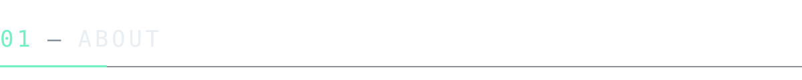
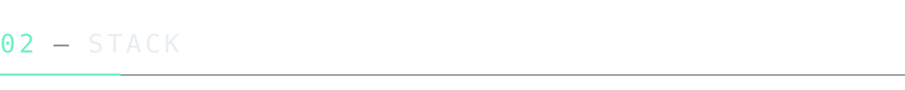
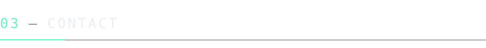

<b>Half developer. Half video editor.</b> 
Shiva Mani · Gen AI · BTech (CSM) · founder of Freelanxo

<a href="mailto:badrishivamani@gmail.com"><b>Email</b></a> &nbsp;·&nbsp; <a href="https://github.com/shivamani-code?tab=repositories"><b>Repositories</b></a>

